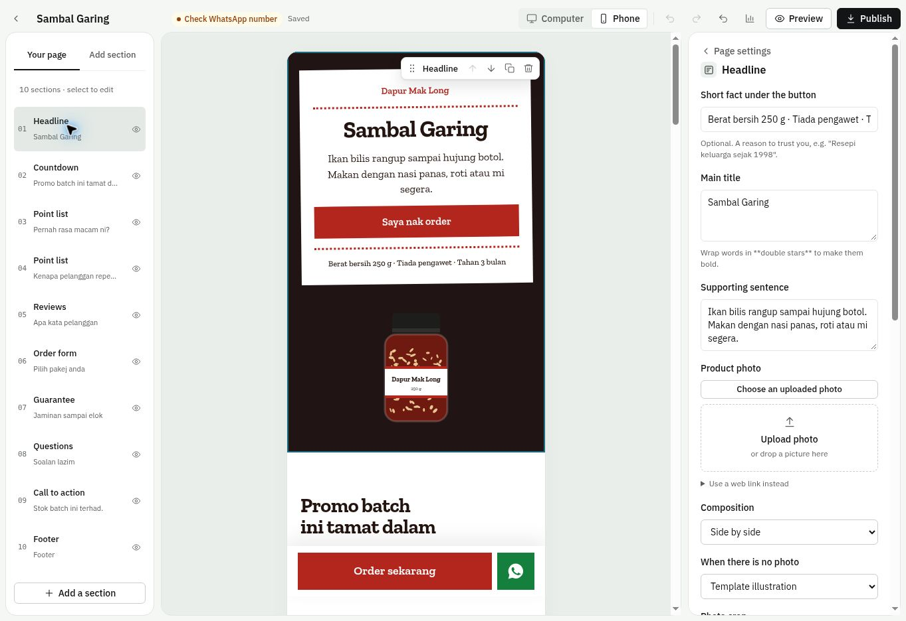

# Nonymauz Salespage Builder

A lightweight salespage studio for Malaysian small businesses. Build a page, preview the buyer experience, and take enquiries through WhatsApp. The editor uses plain JavaScript; downloaded pages remain standalone HTML.

## Run locally

Requires Node.js 22 or newer.

```sh
npm ci
npm run dev
```

Open the Local URL printed by the server. For static-only use, open `index.html` or host `index.html`, `css/`, and `js/` together. Cloud actions require the included server functions.

## Seller workflows

- **Guided setup:** choose a template, enter your business and product details, price, WhatsApp number and photo. Guided pages use supplied facts instead of publishing example reviews, claims or guarantees. Sample templates remain available separately.
- **Section navigator:** jump to a section, hide it from the buyer page, add sections, reorder, duplicate and undo changes. Give sections names such as `benefits` so buttons can link to `#benefits`.
- **Design controls:** five layout styles, colour presets, font choices, reusable local brand kits, page/section spacing, hero composition, replaceable template artwork, image fit and focal points. The food hero is compact on phones.
- **Photo library:** uploaded raster photos are resized and reused across pages. Page records and image assets are stored separately in IndexedDB.
- **Checkout:** package quantities, variants, shipping fees, free-shipping thresholds, pickup without a required address, and preferred appointment dates/times. Customer phone numbers and appointment dates are validated.
- **Launch check:** check the WhatsApp destination, products, photos, example copy, reviews, sharing metadata and button targets before publishing.
- **Backup and recovery:** JSON backups; replace/copy/skip choices when restoring; accurate failure counts; up to 20 recent local versions per page. Edits are flushed before navigation and journaled for recovery after interruption. Storage failures stay visible with a recovery-download action.
- **Buyer preview:** the same HTML that export generates, framed at computer or phone width, without Facebook Pixel. The order button in this preview opens WhatsApp; it does not send a message automatically.
- **Portable export:** download HTML or copy its source for your own hosting. Google Fonts and optional videos/pixels still need network access; the page itself has no builder dependency.

## Optional cloud features on Vercel

The repository includes Vercel Functions and `/p/:slug` routing. Browser-only editing and HTML export work without a cloud connection.

1. Connect a **dedicated Upstash Redis database** to this Vercel project through Vercel Marketplace.
2. Set these server environment variables for the intended environments:

```text
UPSTASH_REDIS_REST_URL
UPSTASH_REDIS_REST_TOKEN
```

3. Deploy the branch. The included `vercel.json` builds the static frontend into `dist/`, bundles the shared renderer, and configures the public-page route.
4. In **Cloud workspace**, create a workspace and save its private recovery key. Connect with that same key on another device. The key is bearer authorization: anyone holding it can read and edit that workspace. It is not an email/password account system.
5. Use **Back up all pages** or **Restore cloud pages** for explicit cross-device transfers. Restore provides conflict choices; there is no silent last-write-wins background sync.
6. Use **Publish** to create a public link. Subsequent publishes keep that link. Publishing saves a snapshot independently of the draft; **Restore live** rolls back the public page without changing the editor draft.

Cloud page documents are limited to 3 MB and workspaces to 100 pages. Large pages can still use portable HTML export. Redis stores draft documents and up to 20 publication snapshots; embedded photos count toward the cloud limit. Choose the datastore plan and retention policy for your expected media volume. Local photos are deduplicated independently.

### Activity and order enquiries

Hosted pages report visits, CTA clicks and WhatsApp handoffs. Counts are approximate browser events, not unique visitors, delivered messages or confirmed sales. Downloaded HTML does not send activity to the builder.

Enable **Save order enquiries online** in page settings before publishing to offer a separate, optional customer consent checkbox. Customer details are recorded only when the buyer opts in. These records are enquiries; WhatsApp still handles the conversation and payment confirmation. Enquiry totals are recalculated against the published products on the server. Only the latest 100 enquiry IDs are listed, with customer records expiring individually after 30 days. Workspace keys and datastore credentials are never embedded in public pages.

### Optional AI copy drafts

AI drafting is off by default. To enable it, select a current `provider/model` ID using `AI_COPY_MODEL` and configure Vercel AI Gateway credentials (`AI_GATEWAY_API_KEY`, or Vercel OIDC). With a connected workspace, guided setup shows **Draft wording with AI**. It sends only the product name, supplied benefit and requested language, and presents the result for review before applying it. Calls are limited per workspace. No customer enquiry data is sent to the model.

## Validation

```sh
npm run check
npm test
npm run build
```

Tests cover save-before-navigation, IndexedDB assets and versions, failed writes, backup conflicts, URL safety, imported data, checkout totals/validation, publishing and rollback, workspace isolation, and consent/retention. Cloud tests exercise the handlers against an in-memory implementation of the Redis REST contract; a real datastore and AI-provider smoke test are still needed after environment provisioning.

## Project layout

```text
index.html                 app shell and load order
css/app.css                original studio design tokens
css/studio.css             dashboard, navigator and workflow UI
js/core.js                 themes, fonts, localisation and URL helpers
js/blocks.js               section schema, edit fields and HTML rendering
js/page-css.js             shared buyer-page styling
js/looks-css.js            Label, Chapters, Shape and Stage compositions
js/studio-page-css.js      responsive refinements and image/spacing controls
js/runtime.js              standalone checkout, countdown and hosted events
js/templates.js            sample templates
js/store.js                IndexedDB, image assets, snapshots and migration
js/studio.js               setup, restore, workspace, launch and activity dialogs
js/export.js               standalone HTML generation
js/editor.js               dashboard, editor, autosave and navigation
api/                       Vercel workspace, public page and event handlers
server/                    datastore, validated renderer and optional copy service
scripts/                   local server, build and syntax checks
tests/                     regression tests
```

The interface retains the existing taste-skill **Framed sheet** direction in `.taste-skill/app/direction.json`. It uses a quiet green-grey frame, white sheets, one typeface and restrained colour. The buyer-facing layout stays independently customisable.

## UI preview



[Guided setup](docs/studio-setup-20261101.jpg) · [Pickup checkout](docs/studio-checkout-20261101.jpg)
